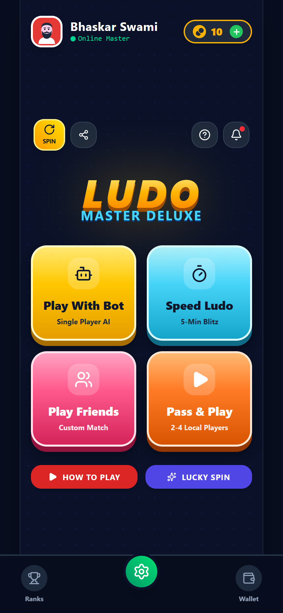
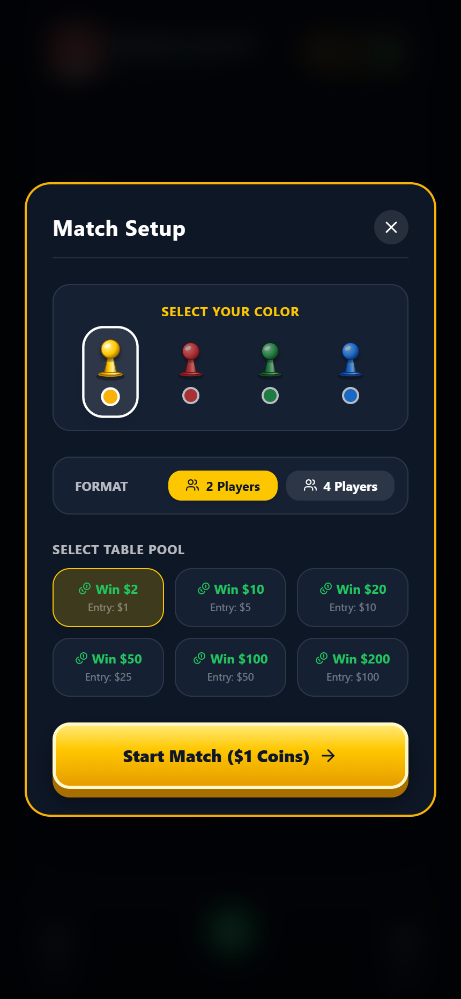
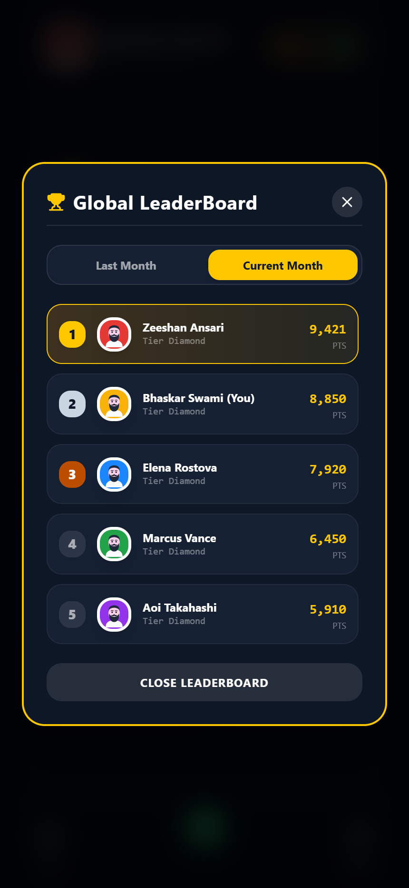
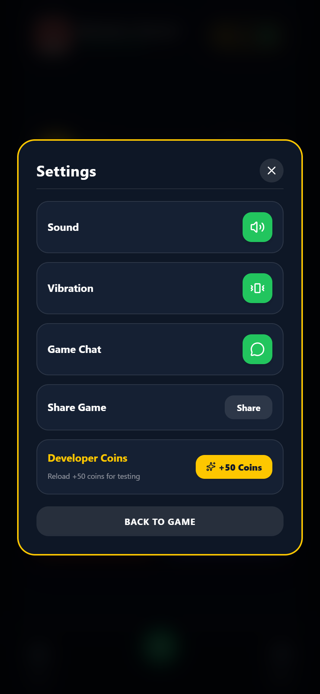
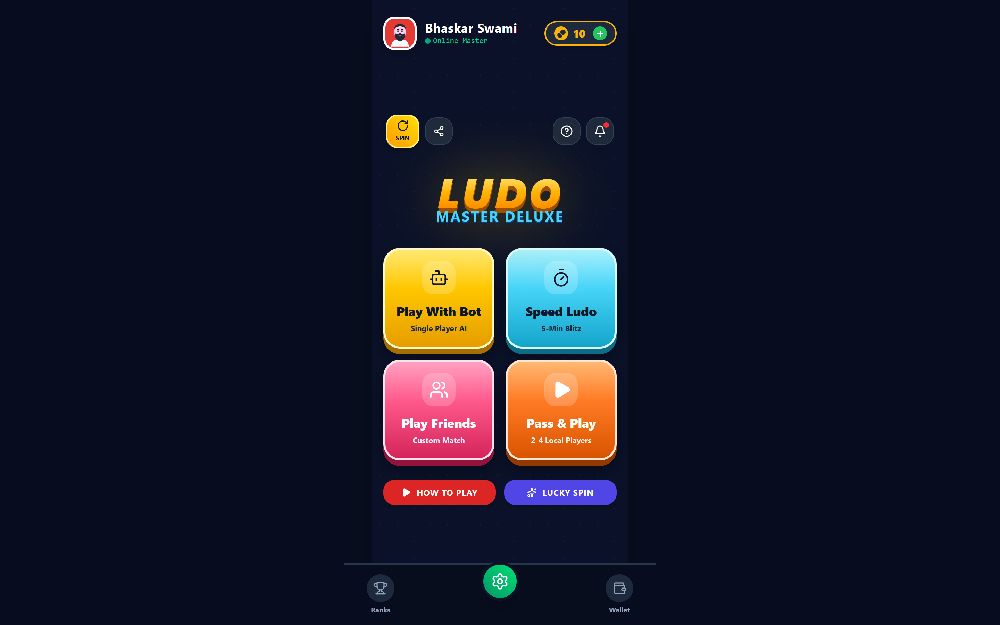
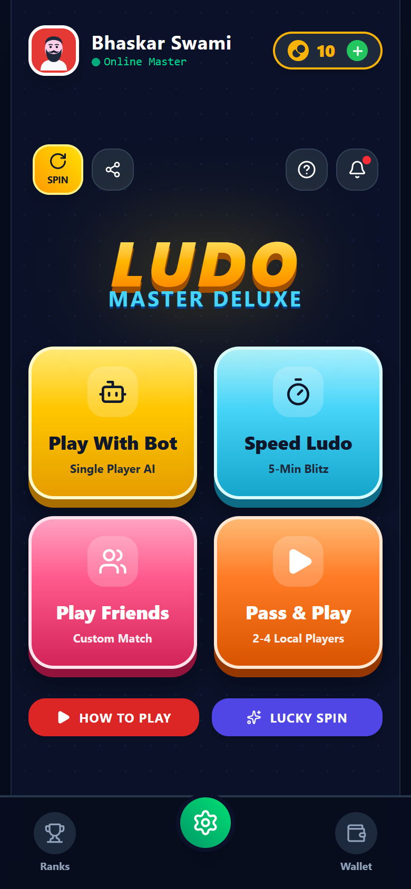

# Deluxe Strategy Board Game

> A complete, interactive web implementation of the classic strategy board game. Built with **React 19**, **Tailwind CSS v4**, and **Lucide Icons**.

[](https://react.dev/)
[](https://tailwindcss.com/)
[](https://vitejs.dev/)
[](LICENSE)

---

## 🎲 Overview

A modern digital board game application featuring 4-color cross and circle track mechanics, interactive 3D dice rolls, smart computer opponents, local pass & play, synthesized web audio sound effects, and victory celebrations.

---

## 📸 Visual Showcase & Previews

| View / Section | Preview |
| :--- | :--- |
| **Main Lobby & Game Modes** |  |
| **Active Gameplay Board** |  |
| **Match Setup Modal** |  |
| **Leaderboard Rankings** |  |
| **Fortune Reward Wheel** |  |
| **Settings & Audio Controls** |  |
| **Desktop Layout** |  |
| **Mobile Standard View** |  |

---

## ✨ Features

- **Standard Board Mechanics**: 15x15 cell layout, safe star squares, private colored home tracks, and center goal.
- **Smart Computer AI**: Automated opponent logic evaluating captures, yard exits, and optimal pawn advancement.
- **Synthesized Audio Engine**: Procedural Web Audio API sound effects for rolling dice, pawn moves, captures, star chimes, and victory fanfares.
- **Multiple Game Modes**: Play against Computer AI, 5-Minute Blitz timer, Custom Match, or local Pass & Play (2 to 4 players).
- **Interactive Fortune Wheel**: Daily reward spin mechanic with celebratory confetti particles.
- **Full Responsive Support**: Optimized for desktop monitors, tablets, and smartphones.

---

## 🛠️ Tech Stack

- **Framework**: React 19
- **Build Tool**: Vite 8
- **Styling**: Tailwind CSS v4
- **Audio Engine**: Web Audio API (Synthesized)
- **Effects**: Canvas Confetti
- **Icons**: Lucide React

---

## 🚀 Getting Started

### Installation

```bash
# Clone the repository
git clone https://github.com/lxlnimalxl/deluxe-strategy-board-game.git

# Navigate into the project directory
cd deluxe-strategy-board-game

# Install dependencies
npm install

# Start development server
npm run dev
```

### Production Build

```bash
# Compile and optimize
npm run build

# Preview build
npm run preview
```

---

## 📄 License

This project is licensed under the [MIT License](LICENSE).
